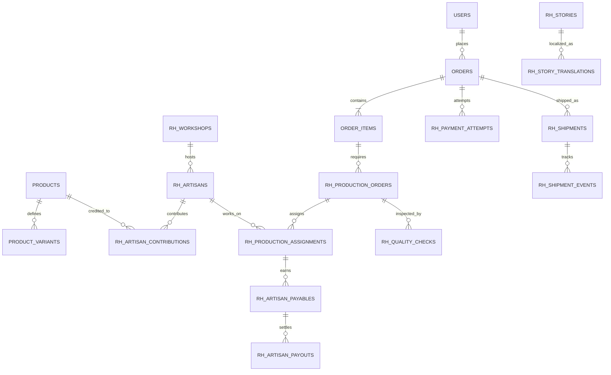

# ROBIT HANDLOOM — Data Model, Integrity Rules, APIs and Events

**Version 1.0 | 11 November 2026**  
**Companion to:** `ROBIT_HANDLOOM_COMPLETE_MASTER_BLUEPRINT.md`  
**Status:** proposed design contracts, NOT existing Liberu migrations. First audit the selected Git SHA and adapt to existing tables, types, policies, modules and single-store semantics.

## 1. Ground rules for database extension

1. **Do not duplicate Liberu models/tables.** Run migrations inventory, model graph and `module:list`, find source of truth for product, variant, customer, cart, order, payment, inventory, store/team, return, shipping.
2. Favor **additive extension tables** referencing upstream PKs; do not edit old migrations in-place on a database with data.
3. Choose **MySQL 8 or PostgreSQL** after inspecting image/Compose and package compatibility; all examples are logical schema, not portable drop-in SQL.
4. Add unique constraints and FKs; use explicit transactions/locking; deterministic reference generation; soft delete only where permitted and with uniqueness handled carefully.
5. Every order captures immutable **price, currency, quantity, tax, shipping and address snapshots**. Repricing the product must not alter past orders.
6. Customer and maker PII is private; any public `ArtisanResource` is a strict allowlist with consent visibility gates.
7. Use UTC timestamps in storage; localize on display; provider times stored with raw and normalized values.
8. Provider callbacks and public tokens must be unguessable and deduplicated.
9. Record domain events with immutable identifiers and an outbox when important post-commit dispatch is needed.
10. A single-store installation does not remove the need to **enforce ownership on every direct identifier lookup**.

## 2. Integration map: reuse or extend

| Concept | Expected Liberu capability (VERIFY) | Robit-specific addition | Source of truth |
|---|---|---|---|
| User and staff auth | users/teams/Filament | workshop roles, MFA and strict policy | existing identity |
| Store/merchant | stores/teams/channels evolving | one Robit storefront configuration | existing store boundary |
| Product/category | catalogue and images | detailed textile specs, provenance | existing product + extension |
| Variants | attributes/variant support | dimensions, unique pieces, made-to-order | product variant/extension |
| Inventory | multi-location mentioned | ledger/reservation/QC physical transitions | audit and select one engine |
| Cart/checkout | Livewire guest/auth flow mentioned | accurate ETB/localized checkout UX | existing hardened checkout |
| Payment | gateway factory/Stripe mentioned | Ethiopia-eligible provider adapter | payment module + attempt ledger |
| Orders | order history/states mentioned | maker/production/fulfillment linkage | existing order tables |
| Returns | RMA claimed | artisanal exceptions and QC disposition | existing RMA if verified |
| Shipping | methods/rates mentioned | Robit hubs, tracking events/export | shipping subsystem + extension |
| Content | not assumed | stories/chapters/consent/localization | new heritage CMS |
| Artisans | not assumed | maker profiles/workshops/contributions | new artisans module |
| Production | not assumed | jobs, assignments, progress, QC | new production module |
| Artisan finance | not assumed | contract/payable/payout ledger | new finance extension |

## 3. Proposed entity dictionary

This dictionary describes **target data**, not necessarily literal table definitions. Names marked `rh_*` intentionally avoid collisions; after repo audit choose names consistent with actual code.

### 3.1 Artisans and governance

**`rh_artisans`**

| Column | Type concept | Rule |
|---|---|---|
| `id` | ULID/UUID or repo PK type | PK; use repo conventions consistently |
| `public_slug` | varchar(160) | unique when public |
| `display_name` | varchar(160) | consent-approved / pseudonym allowed |
| `preferred_locale` | varchar(8) | EN/AM; validation |
| `bio_summary` | nullable text | unpublished until reviewed |
| `workshop_id` | nullable FK | permitted workshop only |
| `status` | enum/string | pending/verified/active/inactive/withdrawn |
| `public_visibility` | bool | false by default |
| `consent_version` | nullable string | current consent reference |
| `created_at`, `updated_at` | timestamp | audited |

**`rh_artisan_private`**: `artisan_id` unique FK; encrypted/restricted `legal_name`, contact, phone/email, payment recipient, identity-document file reference, internal notes, preferred payout method. Do not include these in public serialization, export or full-text search.

**`rh_workshops`**: `id`, approved public name, private contacts, location precision, team lead user ID, capacity estimate, status, audit timestamps. Exact addresses must remain private unless intentionally approved for publication.

**`rh_artisan_skills`**: composite unique `(artisan_id, skill_id)`; proficiency and verified status optional; `rh_craft_skills` taxonomy with EN/AM labels, local pronunciation/alias notes.

**`rh_media_consents`**: `id`, `artisan_id` or valid subject reference, `media_id`, `scope` (website/social/documentary), `consent_text_version`, `consent_at`, `revoked_at`, consent collection language, who recorded, witness/attachment where appropriate. Unpublished if absent/revoked. Consent is not equivalent to perpetual license.

**`rh_artisan_contributions`**: `id`, `artisan_id`, `product_id` and optionally `production_order_id`, `contribution_role` (spinning/weaving/finishing/other), `public_visible`, `description`, approval metadata. Composite deduplication on stable role linkage; flexible for multiple makers.

### 3.2 Product extension and provenance

**`rh_product_specs`**: `product_id` unique FK; material composition text, `material_verified_at`, `width_cm` decimal(9,2), `length_cm` decimal(9,2), `weight_grams` integer, weave density if measurable, `construction_type`, `care_instructions`, `technique_id` nullable, `verification_status`, `verified_by_user_id`, `verified_at`, source/notes. Different physical variants require **variant-level specs** or overrides.

**`rh_variant_specs`**: `variant_id` unique FK; size/weight/pattern/color/material/pack dimensions where distinct; `lead_time_min_days`, `lead_time_max_days`, `production_type` (`stocked|unique|made_to_order|quote_only`), `serial_tracking` bool; publish guard blocks missing critical fields.

**`rh_provenance_records`**: `id`, product/variant/physical-item reference, maker contributions, workshop, process notes, provenance claim level (`maker_reported`, `internally_verified`, `independently_verified` only if real verification exists), public token/slug, approval, published timestamp. Do not call all provenance “certified”. QR should open public allowlisted facts only.

**`rh_terminology`**: `id`, canonical term, script, locale, aliases, approved meaning, source/interviewer, reviewed_at. Do not hardcode inaccurate regional definitions.

### 3.3 Production and QC

**`rh_production_orders`**: `id`, `order_item_id` FK, unique public reference, quantity, variant configuration JSON validated against quote, required dimensions, `status`, planned start/end, actual start/end, workshop ID, notes, `version` optimistic lock, `created_by`, timestamps. One order item may have many production orders if split into units/batches.

**`rh_production_assignments`**: `id`, production order FK, artisan FK, role, due date, agreed amount/currency reference to contract, status, assigned/accepted/completed timestamps; enforce permissions and availability.

**`rh_production_events`**: append-only `id`, order ID, from/to state, actor user ID, source (`staff|artisan|automation`), comment, occurred_at, attachments pointer; no silent overwrite.

**`rh_quality_checks`**: `id`, production order or individual physical item FK, inspector, checklist JSON with version, measured dimensions/weight, outcome (`approved|rework|rejected`), defect codes, evidence media, observed_at, signed-off status; never mark shipped without required QC, unless documented exemption.

### 3.4 Inventory

Choose exactly **one** authoritative inventory ledger after auditing Liberu. If its current engine is safe, extend rather than replace.

**Target semantics:** `inventory_locations`, `stock_movements`, `stock_reservations`, `physical_units` (for unique items), `stock_adjustment_approvals`.

| Operation | Quantity and ledger effect | Invariant |
|---|---|---|
| Receive accepted inventory | positive on-hand movement | ties to QC/receiving |
| Reserve | reserved increases, available decreases | cannot exceed available |
| Expire reservation | reserved decreases | no negative |
| Commit/ship | on-hand decreases and reservation clears | exactly once |
| Return accepted | on-hand increases | inspection required |
| Damage/write-off | on-hand decreases | authorized reason |

For a unique item, enforce a unique available physical-unit allocation or atomic update; a count alone is insufficient under concurrency.

### 3.5 Payment and accounting extensions

**`rh_payment_attempts`**: `id`, order FK, provider, merchant reference unique, idempotency key unique, exact amount (minor units integer or decimal exact), currency code, expected provider merchant, state, initiation timestamps, expires at, verified at, `provider_txn_id` nullable unique where valid, error code, safe metadata (no raw card/credentials). If Liberu already has equivalent, **map and extend**.

**`rh_payment_webhook_inbox`**: provider, provider-event-id unique per provider, signed/auth status, raw body encrypted/retained under policy, received at, handled at, result, retry count, correlation ID. Acknowledge quickly; process exactly-once *effects* via idempotent DB transactions, even if delivery is at least once.

**`rh_payment_reconciliations`**: attempt/order, provider status, amount comparison, currency comparison, last checked, exception reason, resolved by/at.

**`rh_artisan_agreements`**: artisan ID, effective date range, currency, unit/milestone compensation rules, terms version, approved attachments, status and approvers.

**`rh_artisan_payables`**: production assignment/order item, artisan, amount/currency, agreement version, reason, approval and status (`draft|earned|approved|paid|void|disputed`), unique earning reference. Sum approved payables ≠ total payouts automatically until reconciled.

**`rh_artisan_payouts`**: payable relationship (allow partial payouts via pivot), amount/currency, method, external reference, approved by, paid at, status, evidence/document pointer, reversal reference. Reject repeated approval or amount exceeding approved unpaid balance.

### 3.6 Shipping and returns

**`rh_shipments`**: order FK, carrier ID, service, origin, destination address snapshot, quoted price/currency, package actual weight/dimensions, external tracking, status, created/handover/delivered timestamps, customs/claim notes, package label. Sensitive receiver address remains private.

**`rh_shipment_items`**: shipment ID + order-item ID unique in context; shipped quantity and physical units; sum across shipments ≤ ordered quantity.

**`rh_shipment_events`**: shipment ID, source (`carrier|staff`), external event ID unique where provided, source timestamp, normalized event, raw status code, public description, raw metadata, received at.

**Returns:** integrate Liberu RMA if present and proven. For unique or custom items, save reasons, policy eligibility and explicit disposition; restock only after QC.

### 3.7 Editorial CMS and support

**`rh_stories`**: id, type, slug, visibility, author, reviewer, publish/unpublish time, workflow state, SEO reference, revision; `rh_story_translations`: story ID + locale unique, title, summary, content blocks JSON validated against schema, meta title/description, canonical slug/redirects where needed.

**`rh_media_assets`**: media ID, source ownership, rights, focal point, alt text translations, original/checksum, derivatives, video poster/transcript, content moderation status and consent references.

**`rh_support_cases`**: id, customer/order FK, type/priority/state, assigned staff, timestamps; **`rh_support_messages`**: sender, body sanitized, attachments access controlled, internal/public visibility. Never broadcast private maker contacts.

**`rh_domain_audit`**: actor, model/ref, action, safe old/new diff, correlation ID, request context, occurred_at. Redact secrets and private data in audit payload.

**`rh_outbox_events`**: ULID, aggregate type/id, event type/version, payload, published at, retry count, next attempt; use transactional outbox where coupled state/notification reliability is critical.

## 4. Relationship map



Placeholder `USERS`, `ORDERS`, `PRODUCTS`, `PRODUCT_VARIANTS`, `ORDER_ITEMS` refer to **whatever audited Liberu tables actually own those entities**. Relationship counts adapt if existing schema differs.

## 5. Key integrity and concurrency requirements

- Unique `(provider, provider_event_id)` for callbacks; immutable provider merchant reference.
- Unique idempotency key per checkout operation; if the same key repeats with different amount/currency/options, respond conflict.
- Atomic stock reservation using DB locks or a tested optimistic concurrency scheme; no negative available stock.
- Unique physical-unit allocation for one-of-a-kind items.
- Unique SKU per store or globally per business rules.
- Production `version` or row lock for conflicting state transitions.
- Approval and payout recording separated; no self-approval where dual-control policy requires it.
- No private artisan data in public JSON, structured data, logs, exports, or public cache.
- Index `(store_id, status, created_at)` for operational records if a `store_id` exists; use actual audited ownership key.
- Index `(order_id, created_at)` for state history; `(artisan_id, status, due_at)` for assignments; `(shipment_id, occurred_at)` for scans.
- Any public token is random enough not to be enumerable; signed tokens expire and can be revoked.
- Migration backfills must be recoverable and validated against sample real data.

## 6. Domain state contracts

### 6.1 Order lifecycle

`draft → pending_payment → confirmed → fulfilling → completed` and allowed controlled exception paths such as `expired`, `cancel_pending`, `cancelled`, `disputed`. `confirmed` requires verified payment or documented authorized alternative (e.g., invoiced wholesale), not an optimistic browser redirect.

### 6.2 Payment lifecycle

`initiated → provider_pending → verified_paid`, with branches `failed|cancelled|expired|reconciliation_required`. Refunds and disputes have their own records and can coexist with completed fulfillment history. A payment can arrive late after stock expires; route to a compensation decision, do not fabricate inventory.

### 6.3 Production lifecycle

`queued → assigned → in_progress → ready_for_qc → approved → completed`; `ready_for_qc → rework_required → in_progress`, with authorized `on_hold|cancelled`. Each transition has actor, guard, event and optional notification. Manual revision of status requires reason.

### 6.4 Shipment lifecycle

`preparing → handed_to_carrier → in_transit → delivered`, with exceptions and returns. Treat carrier status as external untrusted input; map codes conservatively and preserve original event.

## 7. Application service contracts (illustrative PHP)

```php
interface PaymentGateway
{
    public function initiate(PaymentRequest $request): InitiationResult;
    public function verify(string $providerReference): PaymentVerificationResult;
    public function refund(RefundRequest $request): RefundResult;
    public function verifyWebhook(string $rawBody, array $headers): VerifiedWebhookEvent;
}

interface ShippingRateProvider
{
    /** @return list<ShippingQuote> */
    public function quote(ShippingRequest $request): array;
    public function track(string $trackingReference): TrackingResult;
}

interface ArtisanCompensationService
{
    public function approvePayable(string $payableId, string $approverId): void;
    public function recordConfirmedPayout(PayoutConfirmation $result): void;
}
```

Only create interfaces for genuine variation boundaries. Prefer tests against fake adapters; provider SDKs must not drive business rules.

## 8. HTTP endpoints: proposed and ownership-aware

**Prefer existing SSR/Livewire commerce routes where safe.** Add JSON endpoints only for actual clients or integrations. Proposed versioned API namespace: `/api/v1/...` with explicit policies, rate limits, resource serializers and validation.

| Method | Route | Auth | Core behavior |
|---|---|---|---|
| GET | `/api/v1/products` | Public | Published catalog only, paginated |
| GET | `/api/v1/products/{slug}` | Public | Published variant and consented maker fields |
| GET | `/api/v1/artisans/{slug}` | Public | Consent-approved profile allowlist |
| GET | `/api/v1/stories/{slug}` | Public | Published locale-aware story |
| POST | `/checkout/quote` | Session/guest CSRF | Server-calculated totals, rate eligibility |
| POST | `/checkout/payment-intents` | Session/guest CSRF | Idempotent payment attempt, host redirect |
| POST | `/webhooks/payments/{provider}` | Signed provider webhook | Durable inbox; async idempotent verification |
| GET | `/orders/lookup` | Secure signed guest access | Minimum necessary order tracking |
| POST | `/api/v1/production/{id}/transition` | Workshop/staff | Valid authorized transition |
| POST | `/api/v1/shipments/{id}/tracking` | Staff/integration | Verified event ingestion |
| POST | `/api/v1/custom-quotes` | Auth/verified guest | Validated inquiry, safe media upload |

No endpoint returns raw Eloquent model attributes by default. JSON response resources explicitly whitelist public fields. Use standard error shape appropriate to application; no stack traces and no provider secrets.

## 9. Event and webhook contracts

**Internal event envelope:**

```json
{
  "event_id": "unique-ulid",
  "event_type": "robit.order.payment_confirmed",
  "event_version": 1,
  "aggregate_type": "order",
  "aggregate_id": "opaque-order-id",
  "occurred_at": "2026-11-11T12:00:00Z",
  "correlation_id": "request-or-job-id",
  "payload": { "payment_attempt_id": "opaque-id" }
}
```

Use no customer card numbers, private artisan PII or secrets in event payload. Consumers fetch the authoritative record through scoped service methods.

Event catalog: `OrderPlaced`, `PaymentInitiated`, `PaymentVerified`, `PaymentReconciliationRequired`, `StockReserved`, `StockReleased`, `ProductionAssigned`, `ProductionStageChanged`, `QCFailed`, `QCApproved`, `ArtisanPayableApproved`, `ArtisanPayoutConfirmed`, `ShipmentCreated`, `CarrierEventReceived`, `ShipmentDelivered`, `RefundConfirmed`, `MediaConsentRevoked`, `StoryPublished`.

**Processing example:** webhook HTTP handler verifies signature and stores unique inbox row → queue job locks attempt → queries provider server-to-server → validates expected amount/currency/reference → updates payment and order once → writes outbox → commits → mail and operational jobs run afterwards.

## 10. Example invariant tests

```text
GIVEN product X has one unique physical unit
WHEN buyers A and B concurrently reserve X
THEN at most one reservation is active/committed.

GIVEN the same verified provider event is delivered five times
WHEN webhook jobs execute concurrently
THEN one payment transaction and one order confirmation exist.

GIVEN payment succeeds after inventory reservation expires
WHEN reconciliation runs
THEN order is flagged for compensation; no negative inventory appears.

GIVEN workshop lead A belongs only to workshop X
WHEN A requests production order from workshop Y by guessed ID
THEN request is denied and no fields are leaked.

GIVEN artisan image consent was revoked
WHEN the public CDN asset cache and site pages are checked
THEN affected published content is removed or restricted per policy.

GIVEN order item originally cost 3200 ETB
WHEN product price changes to 3600 ETB
THEN order snapshot remains 3200 ETB.

GIVEN an unauthorized merchant user edits a Filament payment field through Livewire
THEN the policy rejects the operation regardless of UI visibility.
```

## 11. Migration rollout protocol

1. Audit existing schema/constraints/seeders with pinned SHA.
2. Propose additive tables and APIs; draw existing-to-new relationship map.
3. Introduce migration with indexed FKs; test on empty and realistic seeded database.
4. Backfill in batches with dry run, logs and quarantined ambiguities.
5. Dual-read/dual-write only when essential and explicitly time-boxed; monitor divergence.
6. Cut over via feature flag after test and verified backup.
7. Retire old path only after records reconcile and rollback limitations are accepted.
8. Never edit upstream released migrations used by real environments.

## 12. Implementation dependencies

- Schema for artisan consent precedes artisan profile publication.
- Product/variant and stock decisions precede checkout changes.
- Payment attempt + inbox precedes accepting real charges.
- Production orders precede progress notifications.
- QC and shipment allocation precede public delivery timelines.
- Payables approval and reconciliation precede artisan finance dashboard claims.
- CMS translation/versioning precedes full language launch.

**End of data and API contracts.**
